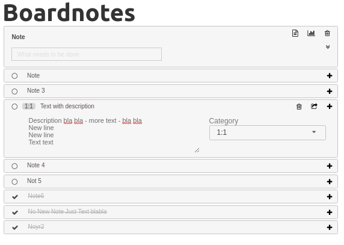

# BoardNotes

BoardNotes adds private, project-specific notes to <a href="https://kanboard.org/" rel="noopener noreferrer">Kanboard</a>. Notes can remain informal or be converted into tasks when they are ready for action.

> **Important:** BoardNotes 0.1.0 requires Kanboard 1.2.54 or later and PHP 8.1 or later. Back up the Kanboard database before upgrading. Notes belong to individual users and are not a shared project discussion area.

## Features

- Create, edit, complete, reopen and delete personal notes for a project.
- Add project categories and transfer notes between accessible projects.
- Reorder notes by dragging them or by using accessible move buttons.
- Convert a note into a task with a selected column, swimlane and category.
- Keep the source note by default; optional removal happens only after task creation succeeds.
- View a personal all-project overview, empty-safe analytics and printable reports.
- Use responsive, keyboard-accessible controls that follow Kanboard's active theme.
- Run without third-party browser requests, fixed installation paths or separate API credentials.

## Screenshots



The screenshot documents an earlier visual release. The current interface follows the same workflow with updated Kanboard-native controls.

## Usage

1. Open a project and select **Notes** from the project navigation.
2. Enter a title and, when useful, a description and category.
3. Open **Details** to edit, move, delete or convert a note into a task.
4. Select **My notes** on the dashboard to review notes across accessible projects.
5. Use **Analytics** or **Print report** from an individual project's notes page.

The task-conversion form includes a **Remove the note after the task is created** option. It is deliberately disabled by default to prevent accidental information loss.

## Installation & Compatibility

| Requirement | Supported value |
| --- | --- |
| Kanboard | 1.2.54 or later |
| PHP | 8.1–8.5 |
| Database | SQLite, MySQL/MariaDB or PostgreSQL |
| Plug-in folder | `plugins/BoardNotes` |

Install from an archive:

1. Download a trusted BoardNotes release archive.
2. Verify the archive using the checksum or signature supplied with that release.
3. Extract it so that `Plugin.php` is located at `plugins/BoardNotes/Plugin.php`.
4. Sign in to Kanboard as an administrator and confirm BoardNotes appears on the plug-ins page.
5. Open one project and complete the acceptance checks below.

Install from Git:

```console
cd /path/to/kanboard/plugins
git clone https://github.com/aljawaid/BoardNotes.git BoardNotes
```

Do not add API credentials or edit a Kanboard base URL. BoardNotes uses Kanboard's generated routes and authenticated session.

### Upgrade acceptance

- Confirm existing notes remain visible to their owners.
- Create, edit, complete and reorder a temporary note.
- Transfer a temporary note to another accessible project.
- Convert a note into a task once while retaining the note and once with removal selected.
- Confirm the all-project overview, analytics and print report work with both populated and empty projects.
- Repeat a representative check in each enabled Kanboard theme and on a narrow screen.

### Rollback

1. Stop user changes or place Kanboard in the maintenance state used by your environment.
2. Restore the pre-upgrade database backup.
3. Replace `plugins/BoardNotes` with the previously verified plug-in directory.
4. Clear any application or PHP opcode cache used by the installation.
5. Repeat the note visibility and edit checks before returning the service to users.

Rolling back plug-in files without restoring the matching database backup is not recommended after schema migration 2 has run.

## Security & Privacy

- Note ownership is derived from the authenticated Kanboard session; browser-supplied user IDs are ignored.
- Every mutation requires Kanboard's reusable CSRF token and an accessible project.
- Note content is sent in request bodies rather than URLs and is escaped when rendered.
- Task conversion revalidates project relationships for the selected column, category and swimlane.
- BoardNotes makes no external browser requests and does not weaken Kanboard's Content Security Policy.
- Deleting a Kanboard user or a real project removes its associated private notes. The built-in custom **General** and **Todo** note areas are not Kanboard projects.

## Troubleshooting

| Symptom | Check |
| --- | --- |
| **Notes** is missing | Confirm the directory name is exactly `BoardNotes` and `Plugin.php` is directly inside it. |
| A project is unavailable | Confirm the signed-in user is a project viewer or member. |
| Task conversion is unavailable | Confirm the project is a real Kanboard project and the user can create tasks in it. |
| A change is rejected | Refresh the page to renew the session and CSRF token, then retry once. |
| Styling looks stale | Clear the browser and application caches; do not edit the compiled plug-in asset paths. |
| Upgrade fails | Restore the database and plug-in backup, then retain the error log for diagnosis. |

For reproducible reports, include the Kanboard version, PHP version, database driver, BoardNotes version, browser and the exact action that failed. Do not include note contents, credentials or session tokens.

## Authors & Contributors

- **Original author:** <a href="https://gitlab.com/u/ThomasTJ" rel="noopener noreferrer">TTJ (ThomasTJ)</a>
- **Current repository maintenance:** <a href="https://github.com/aljawaid" rel="noopener noreferrer">aljawaid</a>
- Thanks to everyone who has reported issues, reviewed changes or contributed code and documentation.

Attribution is intentionally retained from the original project documentation. Contributions should preserve prior author and contributor credits.

## License

BoardNotes is released under the MIT License. See [LICENSE](LICENSE).

## Change history

See [CHANGELOG](CHANGELOG) for release notes and historical changes.
